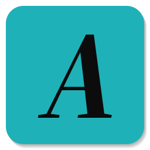

<div align="center">

```
   █▀█ █ █ █ █   █   █▄█
   ▀▀█ █▄█ █ █▄▄ █▄▄  █
```

**Quilly** · a small suite of desktop apps for writing and images

Arch Linux first (`linux` packages in this repo) · the Windows originals live in `windows/`

</div>

| App | Command | What it does |
|---|---|---|
| **Quilly** | `quilly` | The hub: opens the apps and gathers every recent document of the suite in one place. |
| **Noty** | `noty file` | A plain, glassy text editor for `.hyp`, Markdown, `.txt` and `.html`, with a pt-BR spell checker built in. |
| **Artry** | `artry file` | Rich documents and code: a coordinated ruler with sub-rulers, page mode, `.artry`, `.hyp`, `.md`, `.rtf` and `.docx` with formatting, PDF and printing. |
| **Volury** | `volury file` | An EPUB 2/3 e-book editor: chapters, images, CSS, table of contents, validation; imports `.hyp` with its attachments. |
| **Array** | `array image` | An image editor with layers, selection, brushes, text and effects, driven by **Photoshop shortcuts** and tool names. |

The apps are GTK4 + libadwaita windows around a WebKit view; each interface is HTML/JS, the "native side" is a
small Python file. No emoji anywhere, neutral colors, dark by default.

## Install (Arch Linux)

Everything in one file (the hub plus the four apps):

```bash
sudo pacman -U arch-quilly-1.0.0-1-any.pkg.tar.zst
```

Or a single app, without the hub (each one is independent):

```bash
sudo pacman -U arch-array-1.0.0-1-any.pkg.tar.zst
```

Packages are on the [Releases](https://github.com/Sapyst/quilly/releases) page. `pacman` pulls the
dependencies (python-gobject, gtk4, libadwaita, webkitgtk-6.0, and for the writing apps hunspell/enchant,
python-docx and python-markdown; libvips and libraw for Array). The suite package and the single-app packages do not mix: the suite
already contains the apps. Remove with `sudo pacman -R arch-quilly` (or `arch-array`, …).

The suite registers the file types `.hyp` (Hyper document), `.artry` and `.array` with their icons.

## Array



Array is for people who have Photoshop in their fingers. The single-key tools and the Ctrl combinations are the
Photoshop defaults; the tools carry the Photoshop names; `Space` pans, `Z` zooms, `Tab` hides the panels,
`[` and `]` change the brush size, `X` swaps the colors, `D` resets them.

The engine is [miniPaint](https://github.com/viliusle/miniPaint) (MIT), used as an unmodified build: layers,
selection, brushes, clone stamp, text, shapes, gradients, effects, history. Array adds the theme (inspired by
[Pixelorama](https://github.com/Orama-Interactive/Pixelorama)'s flat dark look), the keymap, the tool bar order,
the system open/save dialogs and the `.array` format (miniPaint's JSON with the layers intact).

Layers work the Photoshop way: **blending mode and opacity sit at the top of the Layers panel** (Normal, Multiply,
Screen, Overlay, Darken, Lighten, Color Dodge/Burn, Hard/Soft Light, Difference, Exclusion, Hue, Saturation, Color,
Luminosity), nine effects (blur, brightness, contrast, grayscale, hue, negative, saturate, sepia, shadow) are
non-destructive layer effects you can edit or remove later, image layers keep their original pixels when resized
until you convert them to raster, and text and shapes stay vector until then.

| Key | Tool | Key | Tool |
|---|---|---|---|
| `V` | Move | `S` | Clone Stamp |
| `M` | Rectangular Marquee | `E` / `Shift+E` | Eraser / Magic Eraser |
| `C` | Crop | `G` / `Shift+G` | Paint Bucket / Gradient |
| `I` | Eyedropper | `O` | Sponge (desaturate) |
| `B` / `Shift+B` | Brush / Pencil | `T` | Type |
| `U` / `Shift+U` | Shapes / next shape | `P` | Pen (Bezier curve) |
| `H`, `Space` | Hand (pan) | `Z` (+`Alt`) | Zoom in (out) |

| Keys | Action | Keys | Action |
|---|---|---|---|
| `Ctrl+N` `Ctrl+O` `Ctrl+S` | New, Open, Save | `Ctrl+Shift+S` | Save As |
| `Ctrl+Alt+Shift+S` | Export (quality, preview) | `Ctrl+P` `Ctrl+Q` | Print, Quit |
| `Ctrl+Z` `Ctrl+Shift+Z` | Undo, Redo | `Ctrl+A` `Ctrl+D` | Select All, Deselect |
| `Ctrl+C` `Ctrl+X` `Ctrl+V` | Copy, Cut, Paste | `Delete` | Clear selection |
| `Ctrl+T` | Transform (Move tool handles) | `Ctrl+Shift+N` `Ctrl+J` | New layer, Duplicate layer |
| `Ctrl+E` `Ctrl+Shift+E` | Merge down, Flatten | `Ctrl+]` `Ctrl+[` `Ctrl+,` | Layer up, down, hide/show |
| `Ctrl+I` `Ctrl+Shift+U` | Invert, Desaturate | `Ctrl+U` `Ctrl+L` `Ctrl+B` | Color corrections |
| `Ctrl+Shift+L` `Ctrl+Shift+B` | Auto adjust | `Ctrl+Alt+Shift+B` | Black and White |
| `Ctrl+Alt+I` `Ctrl+Alt+C` | Image size, Canvas size | `Ctrl+R` `Ctrl+'` `Ctrl+;` | Rulers, Grid, Guides |
| `Ctrl++` `Ctrl+-` `Ctrl+0` `Ctrl+1` | Zoom in, out, fit, 100% | `F6` `F7` `F8` | Color, Layers, Info panels |
| `Ctrl+K` | Preferences | `Ctrl+Alt+Shift+K` | Keyboard shortcuts |
| `Ctrl+Shift+X` | Liquify (bulge/pinch) | `Shift+F5` | Content fill |

Keys that Photoshop uses for tools Array does not have (Lasso `L`, Magic Wand `W`, Healing `J`, …) do nothing
instead of triggering something else. The full list is in the app: Help → Keyboard Shortcuts.

### Panels that move

Every panel (Tools, Navigator, Color, Info, Properties, Layers) is grabbed by its header. A short drag
unplugs it: it floats with a lifted shadow, and when it comes near the left or right dock a slot opens between
the panels and snaps it in ("attach"). Dropped anywhere else, it stays floating and clings to the window edges.
The **Window** menu shows and hides panels and restores the default layout; `Tab` hides them all. The layout is
remembered between sessions. Opening, closing, docking, menus and dialogs are all animated (and follow the
system's reduced-motion setting).

### Upscale (Lanczos or AI)

Image → **Upscale…** (`Ctrl+Alt+U`) enlarges the whole document 2×, 3× or 4×: image layers go through the engine,
text and shapes are rescaled and stay editable, and the result is one undo step.

- **Lanczos**: the classic sharp resampling, done by libvips in a fraction of a second.
- **AI – fine detail**: Real-ESRGAN (`realesrgan-x4plus` for photos, `realesrgan-x4plus-anime` for drawings)
  on the GPU through Vulkan. The first use offers to download the official engine release (45 MB) into
  `~/.local/share/arch-quilly/array/realesrgan/`; a system-wide `realesrgan-ncnn-vulkan` is used if present.

Both run as a separate process that starts, works and exits: nothing stays loaded while you edit (the AI takes
about 1.5 GB of RAM and some VRAM only while it runs, a few seconds per layer on an RTX). Temporary files live in
`~/.cache/arch-quilly/array/upscale/` (disk, not RAM) and are removed afterwards. To keep the editor light, a layer
is limited to 8192 px per side and 40 megapixels; the dialog shows the resulting sizes before you confirm.

### Camera Raw

Open a camera RAW file (`.cr2`, `.cr3`, `.nef`, `.arw`, `.dng`, `.raf`, `.orf`, `.rw2`, `.pef`, `.srw` and the other
formats LibRaw reads) and Array shows **Camera Raw**: a large live preview with white balance (as shot or auto),
temperature, tint, auto brightness, exposure, contrast, highlight recovery, wavelet noise reduction, chromatic
aberration, the demosaic algorithm (AHD, DHT, AAHD, DCB, VNG, PPG, linear) and FBDD noise filtering. Click the
preview for 1:1. **Open as image** develops the file at full size, or at half size to keep a 24 MP photo light, into a
new document; the RAW file itself is never written to. The preview is a half-size decode, about 0.2 s per change; the
full development takes a couple of seconds. Both run as separate processes (LibRaw's `dcraw_emu`, then libvips), so
nothing stays loaded afterwards.

## Where things are

- Data: `~/.local/share/arch-quilly/<app>/` (settings, Noty's theme, recent files). Logs: `~/.cache/arch-quilly/<app>.log`.
- Code: `quilly/`, `noty/`, `artry/`, `volury/`, `array/` (each with `ui/` = the interface) and `comum/` (the shared
  GTK4 + WebKit shell, `archhost.py`). To run from the folder without installing: `python3 array/array.py`.
  `ARCH_DEV=1` turns on the web inspector.
- `windows/`: the original C# (.NET + WinForms + WebView2) sources of Quilly, Noty, Artry and Volury, as they were
  on Windows, without build output. `build.ps1` in each folder rebuilds them.
- `icones/`: the app icons; `array/icon.py` regenerates Array's.

## Build the packages again

```bash
./construir.sh
```

Writes `dist/arch-quilly-*.pkg.tar.zst` and one package per app. Needs `base-devel` (makepkg) and
python-gobject with GdkPixbuf for the icon sizes.

## Credits and licenses

- Quilly, Noty, Artry, Volury and Array: [MIT](LICENSE).
- Array's engine: [miniPaint](https://github.com/viliusle/miniPaint) by Vilius L., MIT, vendored unmodified in
  `array/ui/dist` (see `array/ui/UPSTREAM.txt`).
- The pt-BR dictionary in `noty/hunspell/` is the Vero dictionary by its authors (see `README_pt_BR.txt` there).
- Design cues for Array's theme come from Pixelorama; no code is shared.
